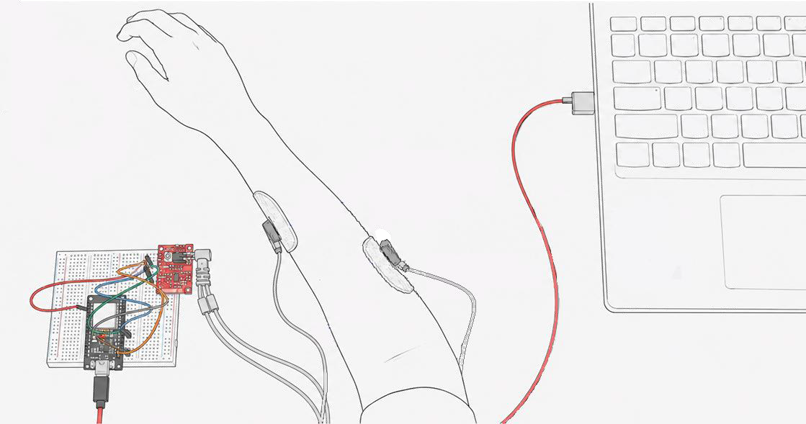
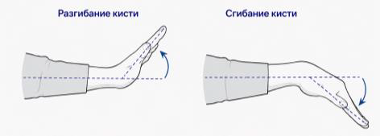
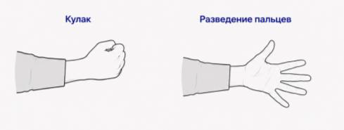
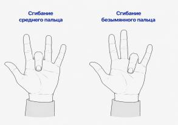
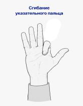
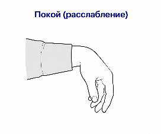
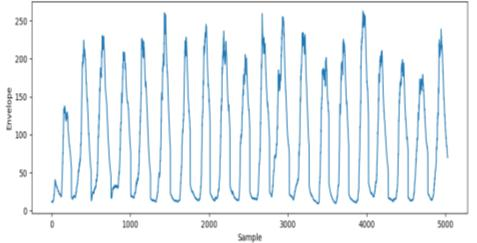
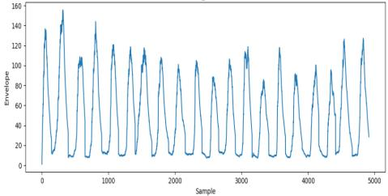

# EMG-управление мобильным роботом (один канал)

Система управления мобильной платформой по электромиографическому сигналу (EMG) мышц предплечья.
Регистрация идет через один канал (AD8232 + ESP32), жесты кисти распознаются моделью машинного обучения,
обученной на данных конкретного пользователя. Команды и сигнал в реальном времени показываются в веб-интерфейсе.

Проект выполнен в рамках НИР «Разработка и исследование биомеханических робототехнических систем»
(МГТУ им. Н.Э. Баумана, кафедра РК-2, 2025–2026).



## Вопрос исследования

Обычно в простых EMG-интерфейсах используют два канала (две мышцы) и набор базовых команд с ручной
настройкой чувствительности. Здесь проверяется, можно ли сделать **одноканальное** управление таким же гибким,
за счет обработки сигнала и обучения модели под пользователя.

## Как это работает

```
электроды на предплечье → AD8232 → ESP32 (АЦП) → Serial → Python
    → сегментация жеста → признаки → Random Forest → команда → робот / веб-интерфейс
```

1. **Регистрация.** Прошивка ESP32 (`firmware/emg_stream.ino`) читает АЦП каждые 20 мс, вычитает плавающий
   baseline, выпрямляет сигнал и строит огибающую (экспоненциальное сглаживание). Активность засчитывается,
   если превышение порога держится 8 отсчетов подряд, а всплески выше порога артефакта (движение кабеля, электродов)
   гасятся на время охлаждения. В порт идут строки `envelope,output`. Электроды RA и LA вдоль мышечных волокон предплечья, опорный RL у локтевого сустава.
   Сравнивались разные варианты расположения электродов и межэлектродного расстояния.
2. **Обработка.** Выпрямление и сглаживание огибающей, пороговая фильтрация.
3. **Признаки** по окну из 25 отсчетов (шаг 10): среднее, СКО, максимум, минимум, RMS,
   сумма модулей (MAV) огибающей, а также статистики порогового сигнала.
4. **Классификация.** `RandomForestClassifier` (scikit-learn, 150 деревьев).
5. **Команды.** Жест сегментируется по активности сигнала. Если уверенность модели ниже 0.65, выдается STOP.
   Для сгибания кисти дополнительно учитывается **длительность** жеста: короткий → FORWARD, средний → LEFT,
   длинный → BACKWARD. Разгибание → RIGHT, покой больше 1.2 с → STOP.
   Так три надежно различимых класса дают пять команд.

## Данные

### Сбор данных

- по 20 записей каждого жеста сохранены в формате CSV;
- электроды RA и LA – вдоль мышечных волокон предплечья;
- опорный электрод RL – в области локтевого сустава;
- дополнительно сравнивались варианты расположения электродов и межэлектродного расстояния.

| | |
|:---:|:---:|
|  |  |
|  |  |
|  |

`data/gestures/`: 9 жестов по 20 записей (около 3 с каждая), CSV `time, envelope, output, label`.

| Файл | Жест |
|---|---|
| `rest_*` | покой |
| `wrist_forward2_*` | сгибание кисти |
| `wrist_back2_*` | разгибание кисти |
| `fist_*` | кулак |
| `razvedenie_*` | разведение пальцев |
| `ukazarelny_*` | сгибание указательного пальца |
| `sredni_*` | сгибание среднего пальца |
| `beziman_*` | сгибание безымянного пальца |
| `shepot_*` | щепоть |

`data/intervals/`: длинные записи серий движений (отдельные пальцы, кулак, длительные сгибания).
`data/early/`: первые пробные записи.

## Результаты

**Управляющий набор (3 класса: покой, сгибание, разгибание)**, `train.py`:

| Класс | Precision | Recall | F1 |
|---|---|---|---|
| Покой | 1.00 | 1.00 | 1.00 |
| Сгибание кисти | 0.86 | 0.89 | 0.88 |
| Разгибание кисти | 0.83 | 0.79 | 0.81 |

Accuracy 0.93 (разбиение по окнам).

**Все 9 жестов**, из презентации НИР:

| Жест | Precision | Recall | F1 |
|---|---|---|---|
| Покой | 1.00 | 1.00 | 1.00 |
| Сгибание кисти | 0.45 | 0.49 | 0.47 |
| Разгибание кисти | 0.21 | 0.22 | 0.21 |
| Кулак | 0.39 | 0.44 | 0.41 |
| Разведение пальцев | 0.23 | 0.23 | 0.23 |
| Сгибание указательного | 0.22 | 0.18 | 0.20 |
| Сгибание среднего | 0.26 | 0.31 | 0.29 |
| Сгибание безымянного | 0.21 | 0.23 | 0.22 |
| Щепоть | 0.20 | 0.15 | 0.17 |

`train_multiclass.py` воспроизводит этот эксперимент со строгим разбиением **по записям**
(окна одной записи не попадают одновременно в train и test). Macro F1 ≈ 0.32, картина та же.

|  |  |  |
|:---:|:---:|:---:|
| Рис. 1. Огибающая EMG – сгибание кисти | Рис. 2. Огибающая EMG – разгибание кисти | Рис. 3. Огибающая EMG – кулак |

### Выводы

- Одноканальная система надежно отделяет покой от активности и уверенно различает базовые движения кисти.
  Этого достаточно для управления платформой.
- Движения отдельных пальцев одним каналом почти не разделяются: их вклад в общий сигнал
  с одной точки предплечья слишком похож. Для тонкой моторики нужна многоканальная регистрация.
- Модель зависит от пользователя: при смене оператора нужны новые записи и переобучение.
  Набор жестов имеет смысл подбирать индивидуально.

**Дальше:** многоканальная регистрация, признаки в частотной области, пропорциональное (а не дискретное)
управление, переход от команд мобильной платформе к управлению многопальцевой кистью / протезом.

## Структура

```
firmware/emg_stream.ino          прошивка ESP32 для Python-части: огибающая, порог, подавление артефактов → `envelope,output`
firmware/emg_peak_commands.ino   альтернативная прошивка: автономный режим без ПК, команды по числу пиков за окно 6 с
record.py                         запись жеста с COM-порта в data/gestures/<жест>_NN.csv
train.py                          обучение модели управления (3 класса) → emg_model.pkl
train_multiclass.py               оценка на всех 9 жестах (разбиение по записям)
live.py                           распознавание в реальном времени, вывод в консоль
live_basic.py                     первая версия live-распознавания (без кодирования длительностью)
web_live.py + templates/          веб-интерфейс (Flask + Socket.IO + Chart.js): сигнал и команды онлайн
emg_model.pkl                     обученная модель
```

## Запуск

```bash
pip install -r requirements.txt

python record.py           # указать LABEL и PORT в начале файла
python train.py
python web_live.py         # http://127.0.0.1:5000
```

Перед этим залить в ESP32 `firmware/emg_stream.ino` (Arduino IDE), сигнал AD8232 на пин 36.
Python-скрипты читают строки `envelope,output` (115200 бод, порт задается в `PORT`).

## Стек

ESP32 · AD8232 · Arduino C++ · Python · NumPy · pandas · scikit-learn · Flask · Flask-SocketIO · Chart.js
